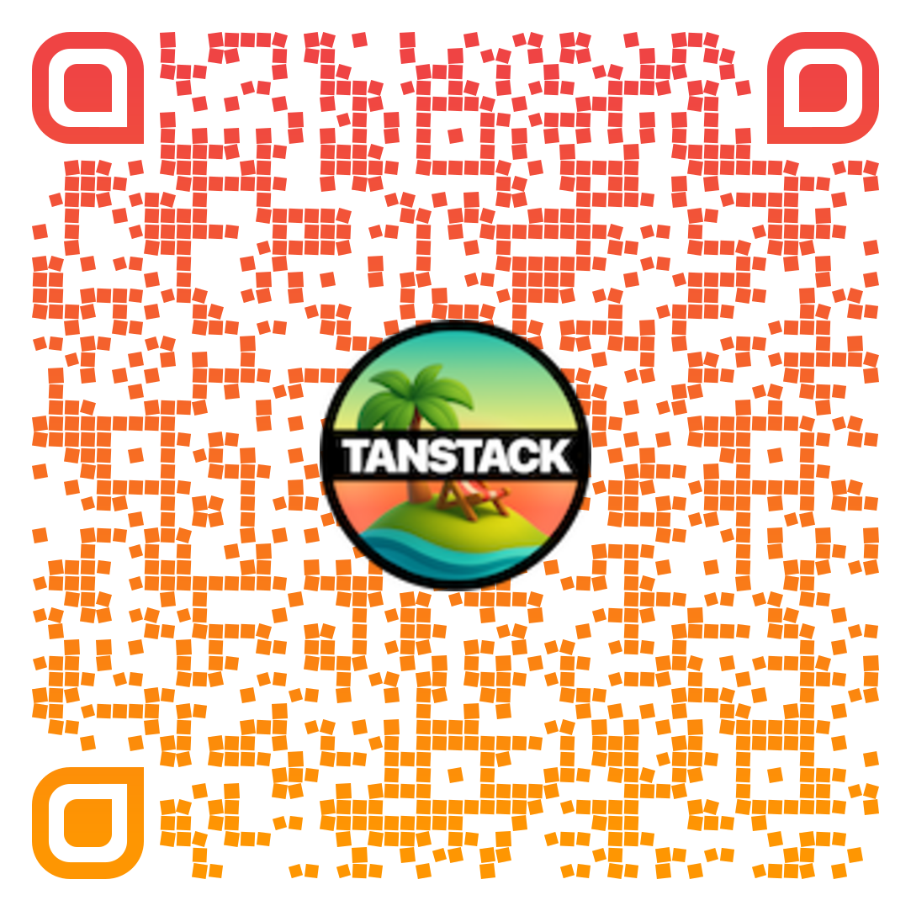

---
title: Photopea - Call
layout: ticket
name: "Alexandre Moreau"
meta: "Développeur — outil graphique en ligne"
photo: "https://placehold.co/160x160?text=Alex"
ticketNumber: "#TSQ-2025-005"
priority: "low"
status: "open"
transition: fade
mdc: true
---

::message::

<Micka />

J'ai besoin de votre aide. Je maintiens depuis quelques années un outil comme photoshop en ligne sous Vue.js avec Pinia, et j'entends la hype me parler de TanStack Query tout autour de moi. Je ne peux me résoudre à ne pas l'utiliser, pouvez-vous m'aider à l'intégrer (si c'est possible) ?

::problem::

Est-ce que TanStack Query est vraiment adapté à une application graphique en ligne comme Photoshop ? Est-ce que ça pose problème que je sois sous Vue.js ? Et surtout, est-ce une bonne idée de migrer de Pinia vers TanStack Query ?

---
title: Photopea - Solution
layout: solution
ticketNumber: "#TSQ-2025-005"
solutionTitle: "Quand NE PAS utiliser TanStack Query"
concept: "Client State Only"
priority: "low"
status: "resolved"
transition: fade
mdc: true
---

::content::

<Section title="TanStack Query n'est PAS fait pour vous ! 🚫" icon="💡">

Votre application d'édition graphique est **100% client-side** :

 

✅ **État du canvas** (layers, pixels, historique...)

✅ **Outils sélectionnés** (pinceau, gomme, texte...)

✅ **Sélections et transformations** en cours

✅ **Historique d'actions** (undo/redo)

✅ **Préférences utilisateur** locales

 

**❌ Aucune donnée serveur !** Tout est géré localement dans le navigateur.

</Section>

---
title: Photopea - Solution
layout: solution
ticketNumber: "#TSQ-2025-005"
solutionTitle: "Quand NE PAS utiliser TanStack Query"
concept: "Client State Only"
priority: "low"
status: "resolved"
transition: fade
mdc: true
---

::content::

<Micka />

<Section title="Concept TanStack Query" icon="⚡" variant="concept">

**<code style="font-size: 0.85em; color: #EF4444; background-color: #FEE2E2; padding: 2px 4px; border-radius: 4px;">TanStack Query n'est PAS un state manager "normal"</code>**

 

Comme on a indiqué, TanStack Query est conçu **spécifiquement** pour gérer le **Server State**  (Fetching, Caching, Synchronisation, Revalidation)

 

**Pour votre application d'édition graphique**, vous avez besoin d'un **state manager "normal"** :

  

    
    
Pinia ✅

  

  
  

    
    
X State

  

  
  

    
    
Zustand

  

  
  

    
    
Redux

  

  
  

    
    
NgRx

  

</Section>

<!--
Lucas : Après il y a quand même des ças où elle pourrait arriver à en avoir besoin..
-->

---
title: Photopea - Solution
layout: solution
ticketNumber: "#TSQ-2025-005"
solutionTitle: "Quand NE PAS utiliser TanStack Query"
concept: "Client State Only"
priority: "low"
status: "resolved"
transition: fade
mdc: true
---

::content::

<Micka />

<Section title="Quand utiliser TanStack Query dans cette app ?" icon="🤔" variant="highlight">

 

Même dans une app d'édition graphique, **quelques fonctionnalités** pourraient bénéficier de TanStack Query :

 

**✅ Utilisez TanStack Query pour :**

• **Charger des templates** depuis un serveur

• **Sauvegarder/charger des projets** depuis le cloud

• **Importer des images** depuis une API (Unsplash, Pexels...)

• **Partager des créations** et récupérer celles des autres

 

</Section>

---
title: Photopea - Solution
layout: solution
ticketNumber: "#TSQ-2025-005"
solutionTitle: "Quand NE PAS utiliser TanStack Query"
concept: "Client State Only"
priority: "low"
status: "resolved"
transition: fade
mdc: true
---

::content::

<Section title="Récapitulatif" icon="📋" variant="highlight">

  

    <strong>🚫 TanStack Query n'est PAS une solution miracle</strong>
    

      <strong>1️⃣ Analyser votre application</strong>
      

        
• Combien de données viennent du serveur ?

        
• Combien sont gérées localement ?

      

    

    

      <strong>2️⃣ Choisir les bons outils</strong>
    

    

      <strong>3️⃣ Ne pas suivre aveuglément la hype</strong>
    

  

  

    

      
    

    <small style="font-size: 0.7em; white-space: nowrap;">💡<a href="https://tanstack.com/query/v5/docs/framework/react/guides/does-this-replace-client-state" target="_blank" style="color: #00B7D8;">TanStack Query - Does this replace client state?</a></small>
  

</Section>
